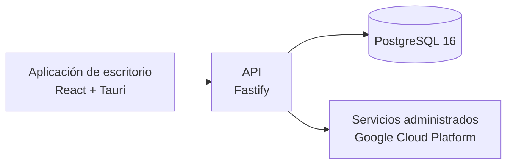

# Sumatoria+Co

**Sumatoria+Co** es una solución en desarrollo para organizar la gestión de proyectos y sus procesos operativos en un espacio común. Busca reducir la fragmentación de información, facilitar la coordinación entre equipos y dar continuidad al seguimiento, la planificación y la documentación.

## Estado del proyecto

La aplicación de escritorio y la base del backend están implementadas y cuentan con validaciones locales reproducibles. Varias áreas funcionales todavía están en integración o funcionan como prototipos. La validación del entorno STAGING para la versión integrada actual está pendiente; el producto no se presenta como desplegado ni certificado para producción.

## Arquitectura, a alto nivel

## Áreas del producto

- **Base de aplicación de escritorio — IMPLEMENTADA.** Interfaz y navegación que reúnen las principales áreas del producto.
- **Gestión y planificación de proyectos — EN DESARROLLO.** Incluye cartera, planificación, tareas y seguimiento; la conexión autoritativa de los flujos sigue evolucionando.
- **Abastecimiento y catálogo — EN DESARROLLO.** Se están integrando los procesos y datos de materiales, solicitudes y compras.
- **Documentación, calidad e integraciones — PARCIAL.** Hay interfaces y capacidades con distintos niveles de integración; algunas siguen siendo demostrativas.
- **Backend y datos — BASE IMPLEMENTADA.** API modular y persistencia relacional con validación local; no todos los procesos funcionales están conectados de extremo a extremo.

## Documentación

- [Proyecto y alcance](docs/01-proyecto.md)
- [Arquitectura](docs/02-arquitectura.md)
- [Módulos y madurez](docs/03-modulos.md)
- [Tecnologías](docs/04-tecnologias.md)
- [Seguridad y calidad](docs/05-seguridad-y-calidad.md)
- [Avance](docs/06-avance.md)
- [Roadmap](docs/07-roadmap.md)

## Equipo

- **Lukas Martínez** — liderazgo técnico, cloud, backend y base de datos.
- **Bastian Vega** — documentación del proyecto.
- **Santiago Vega** — backend e integraciones.

> Este repositorio contiene documentación pública y resumida del proyecto. La documentación técnica completa y el código fuente se mantienen en repositorios privados.
