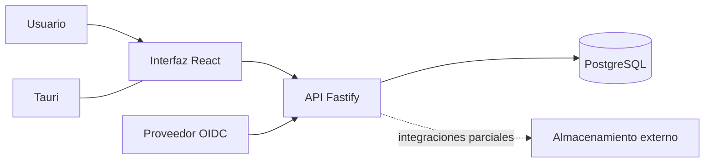

# Arquitectura observada

## Vista lógica

La solución combina una interfaz React, una aplicación de escritorio Tauri, un backend Node.js/Fastify, resolución de identidad y persistencia PostgreSQL. La figura resume componentes y límites; no describe configuración de infraestructura ni asegura que todos los módulos estén conectados.

## Componentes y estado

| Componente | Observación | Estado y límite |
|---|---|---|
| Interfaz | React con vistas para cartera, proyectos, planificación, tareas, compras y catálogo. | PARCIAL: la cobertura de integración varía por módulo. |
| Escritorio | El código Tauri contiene un flujo nativo de inicio de sesión Google con PKCE, intercambio con Identity Platform y sesión mantenida en el runtime nativo. | IMPLEMENTADO en código integrado a `main`; la evidencia de flujo está documentada. No acredita empaquetado, firma ni distribución vigente. |
| Backend | Runtime Node.js/Fastify con rutas de proyectos, identidad, auditoría y almacenamiento. | IMPLEMENTADO en el alcance del código observado; no equivale a producto completo. |
| Identidad | La interfaz de escritorio puede iniciar el flujo Google desde Tauri; el backend conserva validación OIDC y resolución de identidad externa antes del contexto de autorización. | IMPLEMENTADO en el código integrado; los registros describen pruebas del flujo de escritorio y, por separado, una lectura real en STAGING. Ninguna evidencia certifica todos los recorridos. |
| Persistencia | PostgreSQL y repositorios/transacciones aparecen en la arquitectura del backend y en el modelo versionado. Database 2.2.3 agrega creación delegada de proyectos y conserva el contexto del actor. | PARCIAL para el producto completo. La versión 2.2.3 es candidata validada localmente, no un despliegue verificado. |
| Integraciones | Hay adaptadores y flujos documentados para almacenamiento y otros servicios externos. | PARCIAL; no se certifica cada proveedor ni operación. |
| Cloud | Los registros describen preparación y validaciones de staging. | Despliegue DOCUMENTADO; estado actual no verificado directamente. |

## Modelo de datos

El modelo relacional V2.2.0 se declaró congelado para instalaciones nuevas el 26-09-2026 y cuenta con resultados locales documentados. Los registros posteriores describen Database 2.2.2 en STAGING y la validación local del candidato 2.2.3. Este último se integró en `main`, pero no consta desplegado. No se inspeccionó GCP en la fecha de este informe.

La [figura conceptual del modelo](../anexos/modelo-conceptual.svg) agrupa dominios sin exponer tablas, funciones, permisos ni configuración. No implica que todos los dominios tengan un flujo de producto terminado.

## Fuentes

Código de PR-SUM-CO-PC `main` en `ceb973b`; mapa de arquitectura y registros de PR-SUM-CO-DOCS `main` en `cd46933`; release de base de datos V2.2.0 y registros posteriores de migración/runtime. La arquitectura objetivo se trata como diseño, no como prueba de implementación.
