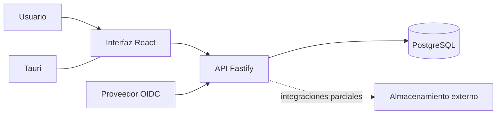

# Arquitectura observada

## Vista lógica

La solución combina una interfaz React, una aplicación de escritorio Tauri, un backend Node.js/Fastify, resolución de identidad y persistencia PostgreSQL. La figura resume componentes y límites; no describe configuración de infraestructura ni asegura que todos los módulos estén conectados.

## Componentes y estado

| Componente | Observación | Estado y límite |
|---|---|---|
| Interfaz | React con vistas para cartera, proyectos, planificación, tareas, compras y catálogo. | PARCIAL: la cobertura de integración varía por módulo. |
| Escritorio | El repositorio incluye configuración y código Tauri. | PARCIAL: no se acredita distribución o firma vigente. |
| Backend | Runtime Node.js/Fastify con rutas de proyectos, identidad, auditoría y almacenamiento. | IMPLEMENTADO en el alcance del código observado; no equivale a producto completo. |
| Identidad | Validación OIDC y resolución de identidad externa a usuario interno antes del contexto de autorización. | IMPLEMENTADO en código; prueba real documentada limitada a una lectura en staging. |
| Persistencia | PostgreSQL y repositorios/transacciones aparecen en la arquitectura del backend y en el modelo versionado. | PARCIAL a nivel de integración completa del producto. |
| Integraciones | Hay adaptadores y flujos documentados para almacenamiento y otros servicios externos. | PARCIAL; no se certifica cada proveedor ni operación. |
| Cloud | Los registros describen preparación y validaciones de staging. | Despliegue DOCUMENTADO; estado actual no verificado directamente. |

## Modelo de datos

El modelo relacional V2.2.0 se declaró congelado para instalaciones nuevas el 26-09-2026 y cuenta con resultados locales documentados. Las migraciones forward posteriores y registros de runtime describen una evolución hasta V2.2.2 en staging. Algunos README de la carpeta de modelo mantienen una descripción anterior que dice que Cloud SQL no estaba desplegado. Este compendio conserva la diferencia temporal: V2.2.0 es la baseline documentada; V2.2.2 en staging es un resultado posterior reportado; no se inspeccionó GCP en la fecha de este informe.

La [figura conceptual del modelo](../anexos/modelo-conceptual.svg) agrupa dominios sin exponer tablas, funciones, permisos ni configuración. No implica que todos los dominios tengan un flujo de producto terminado.

## Fuentes

Código de PR-SUM-CO-PC main; mapa de arquitectura y documentación objetivo de PR-SUM-CO-DOCS; release de base de datos V2.2.0 y registros posteriores de migración/runtime. La arquitectura objetivo se trata como diseño, no como prueba de implementación.
