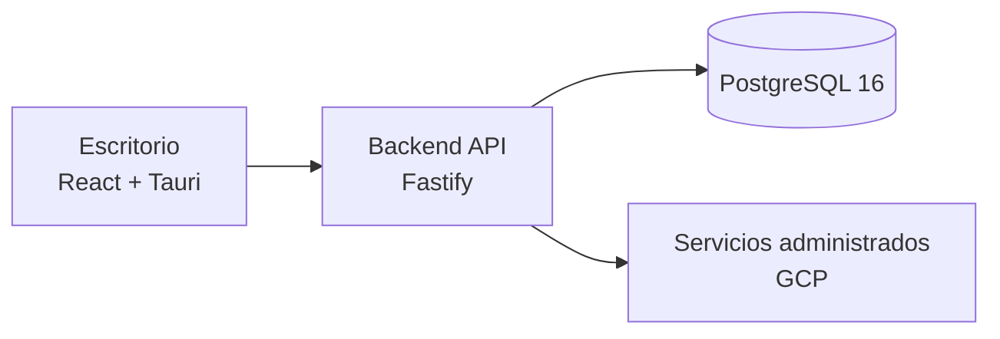

# Arquitectura

## Vista general

La solución se organiza en una aplicación de escritorio, una API backend y una base de datos relacional. La arquitectura también contempla servicios administrados en Google Cloud Platform para una futura operación de los componentes compatibles.

## Aplicación de escritorio

La interfaz está construida con React y se empaqueta como aplicación de escritorio con Tauri. Las vistas reúnen áreas como cartera, proyectos, planificación, tareas, catálogo y abastecimiento. La interfaz y el estado local no se consideran por sí solos una fuente autoritativa para operaciones compartidas.

## Backend y datos

El backend usa Fastify y se estructura como una API modular. PostgreSQL 16 es el motor relacional elegido para persistir y relacionar la información de negocio. La integración entre los módulos de la aplicación, la API y la persistencia se completa de forma progresiva.

## Entorno cloud

La arquitectura contempla servicios administrados de Google Cloud Platform, incluidos servicios de ejecución, base de datos, identidad y gestión de secretos. La composición local y las pruebas de contenedor no equivalen a validar un despliegue en STAGING o producción. La validación de STAGING para la versión integrada actual sigue pendiente.

## Límites de esta vista

Este diagrama es conceptual. No muestra topología de red, recursos concretos, rutas de API, configuración de identidad, permisos de infraestructura ni parámetros de conexión.
